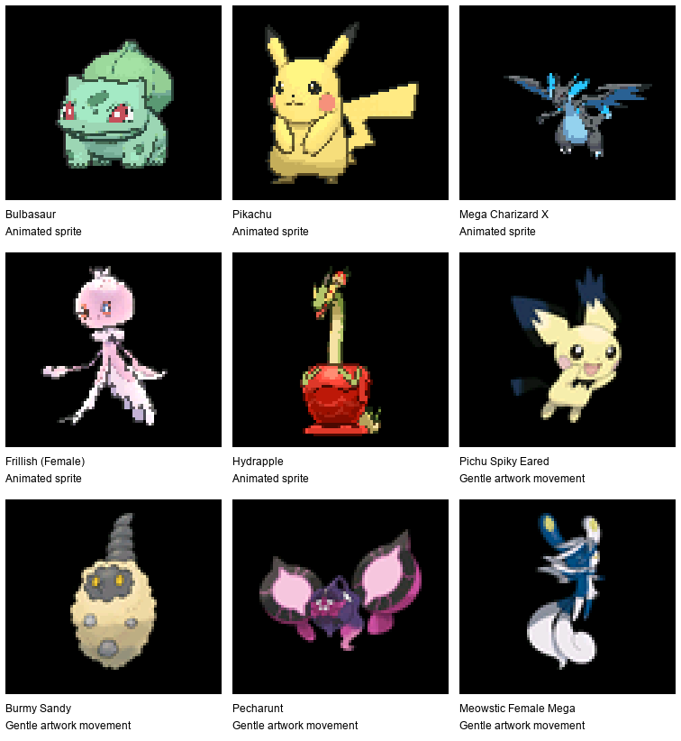

# Waveshare PICODEX Animated

An offline animated Pokémon catalog for the **Waveshare RP2350-Touch-LCD-1.54**,
running MicroPython 1.29 (mpy format v6.3). It shows a five-second Pokémon splash,
then enters PICODEX directly, with no menu, companion game or charging indicator.

**Every one of the 1,538 entries has animation data:**

- **1,396** use matching animated sprites from the pinned PokeAPI Showdown set.
- **142** use gentle vertical movement of their own original artwork where a
  matching animated sprite is absent or static. These do not invent new poses.

The entry count, form names, national numbering and Spanish descriptions are
preserved. Female and other alternate artwork entries are mapped individually;
missing forms are not replaced by another form's sprite.



## Controls

- Tap the left/right third of the screen, or short-press the left/right button,
  for the previous/next entry.
- Hold the centre of the image for about one second to read its description.
  Animation pauses while holding and reading; the player is unloaded during
  reading and restored at its saved frame position afterward. Tap through pages; the final tap
  restores the held frame and resumes playback.
- Hold the right button for two seconds to return to the first Pokémon.
- Move gently to choose another entry. Let the device settle before shaking again.
- Hold the left button for about two seconds to show `GOODBYE!` and switch off on
  battery. USB can keep the board powered after the screen switches off.

Normal startup begins at the first Pokémon. USB charging is handled by hardware;
there is no battery percentage popup or charger-status logging.

## Board and SD installation

Copy these files to the board root, staging and checking hashes before activation:

```text
main.py
boot_splash.mpy
boot_splash.dat
lcd.mpy
frame_app.mpy
pokemon_footer.mpy
pokemon_animation.mpy
dex_description.mpy
shutdown_screen.mpy
sdcard.mpy
pokemon_order.bin
pokemon_dex.bin
pokemon_descriptions_es.bin
```

An existing working Waveshare `lcd.py` may remain on the board. Its `.py` takes
precedence over the supplied `.mpy`. The source driver and its compiled version
are both included here for reproducibility.

Put the following on a FAT microSD card (mounted as `/sd` by the app):

```text
/waveshare_pokemon_frame/pokemon_hd.dat
/picodex_animations/pack-00.bin
/picodex_animations/pack-01.bin
...
/picodex_animations/pack-12.bin
```

The old artwork path is retained to reuse an existing SD card. The 13 animation
packs total **101,579,907 bytes (96.87 MiB)**. The original 30.7 MiB artwork archive
is retained for entry metadata and recovery if an animation file is damaged or
missing. With all packs installed, every entry animates normally. Source and
output hashes, exact form mapping and generated-motion flags are in
[`assets/animations/manifest.json`](assets/animations/manifest.json).

### Transfer over USB

Use `uv tool run mpremote connect list` to find the port. Back up the device
files before changing them. For long transfers, temporarily replace `main.py`
with a tiny maintenance entry point that holds GPIO28 high but does not start
a watchdog, then perform a hardware reset. This avoids watchdog resets during
uploads. Keep the backed-up normal `main.py` for final activation.

To transfer the animation packs to a board already in maintenance mode:

```sh
uv run --no-project --python 3.11 --with pyserial python tools/transfer_animations.py --port /dev/cu.usbmodem1101
```

This writes only named animation packs under `/sd/picodex_animations`, not other
SD content. It stages files, checks received SHA-256, and preserves a prior
version as `.previous` before activation. Existing matching packs are skipped.
An interrupted pack remains staged and can be retried. Remove neither the card
nor the cable during the transfer. A card reader can copy the same 13 files much
faster than this board's current USB serial path.

After uploading firmware, read back and verify the pack checksums, activate
`main.py` last, then reset. A failed or incomplete animation falls back to the
original artwork for that entry rather than freezing the whole catalog.

## Building

Compile the firmware with MicroPython 1.29 mpy-cross:

```sh
for module in boot_splash lcd frame_app pokemon_footer pokemon_animation dex_description shutdown_screen sdcard; do
  uv tool run --from mpy-cross mpy-cross "$module.py"
done
python3 -m unittest discover -s tests -v
python3 validate_assets.py
python3 validate_animations.py
```

The animation source is pinned to PokeAPI/sprites commit
`c0542f7c51215d9672439012838c99f520596cbd`. Download only the relevant GIFs:

```sh
mkdir -p .cache/animations
git clone --filter=blob:none --sparse https://github.com/PokeAPI/sprites.git .cache/animations/upstream
git -C .cache/animations/upstream checkout c0542f7c51215d9672439012838c99f520596cbd
git -C .cache/animations/upstream sparse-checkout set --no-cone '/sprites/pokemon/other/showdown/*.gif' '/sprites/pokemon/other/showdown/female/*.gif'
uv run --no-project --python 3.11 --with pillow --with numpy python build_animations.py
```

The builder checks every source ID and label against the original artwork index,
scales GIFs into at most 64 × 64 source pixels, and samples to at most 64 frames.
Horizontal 3× scaling is done on the host; rows repeat vertically 3× on the board,
producing sprites up to 192 × 192 pixels. Each frame is compressed independently
with raw DEFLATE and a 512-byte window. The player streams one row at a time into
the existing framebuffer. It does not load an entire animation or catalog into
RAM and does not allocate a second 115,200-byte framebuffer.

`PKA3` animations are grouped into `PAX1` packs, with up to 128 indexed entries per
pack. The runtime uses original artwork archive positions, keeping separate
assets for entries sharing a species number. Pack offsets and sizes are bounded
before playback. The byte-swapped RGB565 display convention is preserved.

The SD driver continuously polls response bytes with the original 100 ms
wall-clock deadline instead of sleeping 1 ms after each filler byte. This avoids
artificial read latency without creating an unbounded wait. Actual frame rate
still depends on the sprite, card and display; it is not guaranteed to match the
source GIF. The older Pikachu prototype measured about 2.1 fps before this change.

The heap is limited: preserve `gc.threshold(1024)`, compile modules, and allocate
the LCD framebuffer before loading the application. The footer renderer is loaded only when changing entries, then unloaded.
Description return uses a flash-backed snapshot to avoid re-decoding artwork on
a low heap; animation code and row buffers are released during reading and
recreated at the saved playback position on return. Power handling
runs before touch rendering, and shared I2C reads have a 50 ms timeout.

Rebuild the Spanish description binary with `python3 build_descriptions.py`.
Rebuild the splash with
`uv run --with pillow --with resvg-py python build_boot_splash.py`.

## Verification

- Ten host tests pass, including pack bounds, colour layout, timing,
  playback-position restoration, snapshot integrity and SD read timeouts.
- All 1,538 animations and all 64,639 frames decode successfully and each entry
  has at least two distinct frames.
- All 13 packs were read back from the board SD card and matched SHA-256.
- On-board tests passed for Bulbasaur, Pikachu, Mega Charizard X, female Frillish,
  Spiky-Eared Pichu, Pecharunt and Mega female Meowstic. Each test checks playback,
  the held-frame checksum on description return, and continued playback.
- Repeated browsing across 12 entries, including Mega/Gigantamax forms, passed.
- Shutdown reaches the power latch even with simulated touch-read failures.
- Normal startup was observed: 5,003 ms Pokémon splash, then animated Bulbasaur,
  without a menu or charging popup.

Sampled frame rates ranged from about **1.6 to 5.4 fps**; animations are not
universally smooth or guaranteed to match their original GIF rate. Minimum free
heap in the instrumented seven-entry test was 4,080 bytes. The test inputs are
simulated; physical touch feel and battery power cutoff still need owner use.

For hardware checks, compile and upload `tests/hardware_catalog.py`, then invoke
`hardware_catalog.run(order_index)` via mpremote. `tests/hardware_browsing.py` and
`tests/hardware_description_shutdown.py` exercise navigation and shutdown.
The private `_probe` callback is only for validation; normal startup does not use
it. Restore/restart the ordinary main entry point after a diagnostic session.

## Sources and rights

This project preserves the development history of
[persanz/waveshare-picodex](https://github.com/persanz/waveshare-picodex), originally
based on [waveshare-pokemon-frame](https://github.com/persanz/waveshare-pokemon-frame).
The static PICODEX repository remains separate.

Animation provenance is in [`assets/animations/SOURCES.md`](assets/animations/SOURCES.md).
Spanish descriptions retain per-entry translation provenance. Splash attribution
is in `assets/splash/SOURCES.md`. Driver notices are preserved. Pokémon artwork,
sprites, names and trademarks belong to their respective owners; no new license
grant over upstream artwork is asserted.
